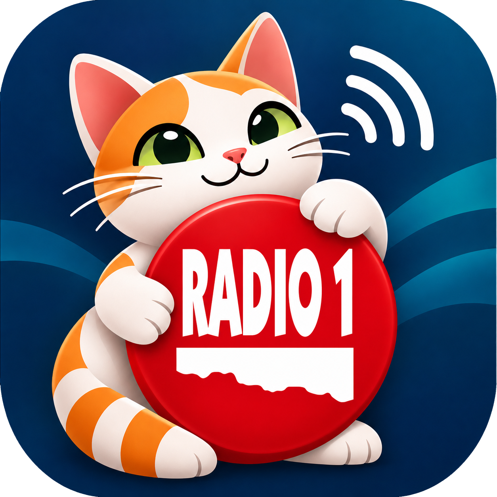

# Felis Radio 1 pro Sailfish OS

[English README](README.en.md)

Neoficiální přehrávač českého [Radia 1](https://www.radio1.cz/) pro Sailfish OS.
Součást rodiny aplikací Felis. Vyvíjeno a testováno na Jolla Phone 2026 (aarch64).
Veřejná verze: **1.0.0** (RPM **1.0.0-1**). Funkce byly ověřeny
na Jolla Phone 2026 v předchozím buildu 0.1.0-22.



## Co aplikace umí

- Živé vysílání v telefonu nebo přes Chromecast, včetně Cast audio skupin.
- Informace o právě hrané skladbě, pokud je stanice poskytuje.
- Hlasitost, ztlumení, ovládání na coveru a přes MPRIS (např. zamykací obrazovka).
- Plynulé posouvání dlouhého názvu skladby na aktivní hlavní stránce.
- Jeden časově omezený pokus o obnovu přerušeného lokálního streamu.
- Návrat na telefon po ztrátě Castu a seznam zařízení platný pro aktuální Wi-Fi.
- Anglické výchozí rozhraní a český překlad podle jazyka systému.

Radio 1 nabízí alternativní hudební dramaturgii, autorské pořady a kulturní servis.
Více informací přímo [o Radiu 1](https://www.radio1.cz/o-radiu-1/).
Aplikace není oficiálním produktem stanice.

## Používání

Vyber zvukový výstup a stiskni **Přehrát**. Pauza v systémovém ovládání se
pro živé rádio chová jako Stop; další spuštění začne živým vysíláním.
Zvuk do reproduktoru nebo Bluetooth zařízení směruje Sailfish OS.
Dlouhý název se pohybuje pouze při přetečení a na aktivní stránce; cover zůstává statický.

Casty hledej v nabídce **Zvukový výstup** nebo přes **Obnovit zařízení**.
Telefon a Chromecast musejí mít vzájemně dostupnou síť. Aplikace používá vlastní
Google Cast Web Receiver pro rychlejší spuštění živého streamu Radia 1;
standardní receiver měl při našich testech dlouhou prodlevu. Více o této
technologii v [oficiální dokumentaci Google Cast](https://developers.google.com/cast/docs/web_receiver).

Při přechodu z dostupného Castu na telefon aplikace vzdálené přehrávání zastaví.
Při ztrátě spojení může Cast hrát samostatně dál. Návrat na telefon ho v takovém
případě nemůže zastavit, ale nezablokuje se. Při běžném zavření aplikace se
aplikace pokusí vzdálené přehrávání zastavit.

Při přerušení lokálního streamu aplikace zkusí jednou obnovit živé vysílání,
nejvýše po dobu 20 sekund včetně čekání na síť. Neúspěch zobrazí výzvu k ručnímu
spuštění. Stop i výběr Castu čekající obnovu zruší. Streamování a metadata
spotřebovávají mobilní data; aplikace automaticky neomezuje jejich použití.

## Instalace a sestavení

Nainstaluj odpovídající aarch64 RPM standardním způsobem v Sailfish OS.
Před aktualizací ukonči běžící aplikaci. RPM vytváří Sailfish SDK, nikoli hostitelský openSUSE rpmbuild.

Potřeba je Sailfish SDK s cílem `SailfishOS-5.1.0.11-aarch64.default`, Python 3.11
na telefonu a připravený archiv `vendor/runtime.zip`. Archiv není součástí Gitu.
Ze stávajícího ověřeného runtime projektu FelisMusic-SFOS ho připravíš:

```sh
python3 -B tools/prepare_vendor.py /cesta/k/FelisMusic-SFOS/vendor/runtime.zip
```

Vstupní projekt ani archiv se nemění. Pokud tento runtime nemáš, nejprve ho
připrav podle build návodu [FelisMusic-SFOS](https://github.com/MiPal666/FelisMusic-SFOS).
Seznam verzí a zdrojových archivů je v [manifestu závislostí](docs/DEPENDENCIES.json).

```sh
bash tools/build-rpm.sh
```

Skript nejprve spustí testy a pak SDK build. Cestu k SDK a cíl lze změnit přes
`FELISRADIO1_SFDK` a `FELISRADIO1_SDK_TARGET`. Výsledné RPM je v `RPMS/`.
SDK při instalaci balíčku přeloží český katalog pomocí Qt 5 `lrelease`.

## Vývoj a diagnostika

```sh
python3 -B -m unittest discover -s tests
```

Hostitelské testy používají testovací audio a Cast adaptéry; nenahrazují skutečnou
Jollu, Silica UI ani Chromecast. Pro QML integrační testy je potřeba Qt 5 qmlscene
(`qmlscene-qt5`); některé kontroly používají Node.js a Qt Linguist.

Běžné spuštění nevypisuje podrobné diagnostické události. Na Jolle lze zapnout:

```sh
FELISRADIO1_DIAGNOSTICS=1 sailjail /usr/bin/harbour-felisradio1 > /tmp/felisradio1.log 2>&1
```

Diagnostika obsahuje síťová rozhraní a místní IPv4; neukládá SSID, hesla ani
URL tokeny. Volitelný nativní `GST_DEBUG` není filtrován tímto loggerem.

Zaznamenaný, zatím nereprodukovaný **exit 139 při ukončení** zůstává otevřený.
Jeho reprodukce je součástí závěrečného testování; není prohlášený za opravený.

## Licence a autor

Copyright © 2026 Michal Kasík (MiPal). Vytvořeno s pomocí Kláry (AI).
Kód aplikace: **GPL-3.0-or-later** — GNU GPL verze 3 nebo kterákoli novější;
plné znění v [LICENSE](LICENSE), vymezení v [COPYRIGHT](COPYRIGHT).
Komponenty třetích stran: [THIRD_PARTY.md](THIRD_PARTY.md).
Název, logo a vysílání Radia 1 zůstávají příslušným držitelům práv.

Zdrojové kódy a hlášení chyb: <https://github.com/MiPal666/FelisRadio1>.
